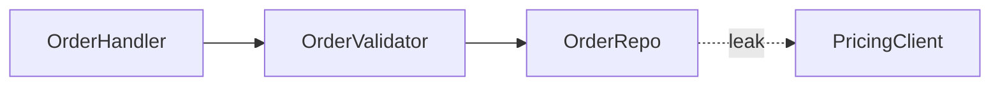

# Writing up candidates

The write-up is Markdown, so it reads the same in a chat reply, a terminal
and a `docs/plans/` file on GitHub. Diagrams are Mermaid where the shape is a
graph, and plain text boxes where it isn't. Nothing loads from a CDN.

## Layout

```markdown
# Architecture review: <area>, <date>

Scope: <the direction the user gave, or the hot spots and how far back you looked>

## 1. <Short title naming the deepening>
...one card per candidate...

## Top recommendation
<Candidate name>. <One sentence on why.>

Which of these would you like to explore?
```

No introduction paragraph. Straight into the candidates.

## A candidate card

- **Title:** names the deepening. "Collapse the Order intake pipeline", not
  "Refactor order code".
- **Strength:** `Strong`, `Worth exploring` or `Speculative` (below).
- **Dependencies:** in-process, local-substitutable, remote but owned, or
  true external (see `codebase-design`).
- **Ask list:** the area it touches, if any, from the built-in list or the
  `Ask list` line in Project gates, with "needs `ssa-ask` and your
  decision". Leave the line out when there is none.
- **Files:** a code-formatted list.
- **Problem:** one sentence. What hurts.
- **Deepening:** one sentence. What changes, in plain words. Not the new
  interface; that comes after the pick.
- **Wins:** short bullets in the vocabulary. "locality: pricing bugs land in
  one module", "leverage: one interface, six call sites", "tests: one
  interface replaces four shallow test files". Never "cleaner" or "easier to
  maintain".
- **Before / after:** the sketch. If it needs a paragraph to be understood,
  redraw it.
- **ADR:** one line, only when it contradicts one: "Contradicts ADR-0007;
  worth reopening because ...".

## Strength

| Strength | Means |
|---|---|
| `Strong` | Passes the deletion test clearly, in code that changes often. |
| `Worth exploring` | A plausible deepening; the payoff depends on where the code goes next. |
| `Speculative` | Included for completeness. Most can be ignored. |

Be honest with these. They are how the reader corrects for a skill whose job
is to find things.

## Sketches

Pick the shape that fits. Don't make every sketch look the same.

**Call graph (Mermaid).** For "X calls Y calls Z, and look at the mess".
Mark the leak.



**Cross-section (text).** For layered shallowness: before, several thin
layers each doing little; after, one thick module.

```
Before            After
| handler    |    +----------------------+
| validator  |    | Order intake         |
| mapper     |    |  (validate, price,   |
| repo       |    |   persist: internal) |
                  +----------------------+
```

**Mass (text).** For "interface as wide as the implementation": two bars per
module, interface over implementation. Shallow has bars of a similar length;
deep has a short interface bar over a long one.

## Wording

Plain and short. The architecture nouns come from `codebase-design`, the
domain nouns from `GLOSSARY.md` if there is one.

- "Order intake module is shallow: its interface nearly matches its
  implementation."
- "Pricing leaks across the seam."
- "Deepen: one interface, one place to test."
- "Two adapters justify the seam: HTTP in production, in-memory in tests."

No hedging and no throat-clearing. If a sentence could be a bullet, make it
one. If a bullet could go, cut it.
